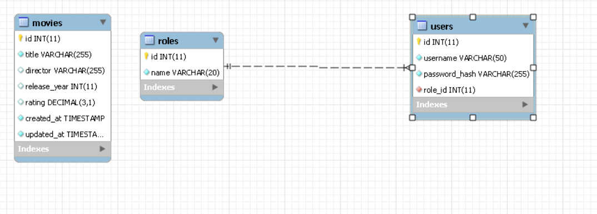

# Secure Movie Library & Background Rating Aggregation

## Project Overview

Secure Movie Library is a FastAPI application that allows users to manage a catalog of movies and automatically enrich them with rating data retrieved from an external movie API.

When a new movie is created, the system stores it in the database immediately and starts a background process that retrieves the movie rating from an external API (OMDb API). The rating is then saved to the local database without blocking the original request.

The API is secured using JWT authentication and role-based authorization.

---

# Features

* Secure REST API built with **FastAPI**
* **JWT authentication**
* **Role-based authorization** (ADMIN / USER)
* Full **CRUD operations** for movies
* **Background rating enrichment** using an external API
* Filtering and sorting of movie catalog
* Input validation using **Pydantic**
* Direct **SQL queries** (no ORM used)
* Error handling with consistent API responses
* Integration tests

---

# Technology Stack

* Python
* FastAPI
* MySQL Workbench
* MariaDB
* Pydantic
* JWT Authentication
* OMDb API
* HTTPX / Requests

---

# Project Structure

```
movie_library/
│
├── auth
│   ├── jwt_handler.py
│   ├── password_hash.py
│   └── security.py
│
├── db
│   └── connection.py
|   └── connection.py
|   └── scripts.sql
│
├── models
│   ├── movie_models.py
│   └── user_models.py
│
├── routers
│   ├── movie_router.py
│   └── user_router.py
│
├── services
│   ├── movie_service.py
│   ├── rating_service.py
│   └── user_service.py
│
├── tests
│   └── test_enrich_rating.py
|   └── test_movies_service.py
|   └── test_user_service.py
│
├── main.py
└── README.md
```

---

# Database Schema (ER Diagram)



---


---

# Installation

Clone the repository

```
git clone https://github.com/yourusername/movie.git
cd movie-library
```

Create virtual environment

```
python -m venv venv
```

Activate virtual environment

Windows

```
venv\Scripts\activate
```

Mac/Linux

```
source venv/bin/activate
```

Install dependencies

```
pip install -r requirements.txt
```

---

# Environment Variables

Create a `.env` file in the root directory.

Example:

```
DB_USER=your_user
DB_PASSWORD=your_password
DB_HOST=localhost
DB_PORT=port
DB_NAME=db_base_name

OMDB_API_KEY=OMDb API key
SECRET_KEY=123 
```

You can get a free OMDb API key from:

http://www.omdbapi.com/apikey.aspx

---

# Running the Application

Start the FastAPI server:

```
uvicorn main:app --reload
```

API documentation will be available at:

```
http://127.0.0.1:8000/docs
```

---

# Authentication & Authorization

The API uses **JWT tokens** for authentication.

Users can register and login to obtain an access token.

Roles:

ADMIN

* Can create movies
* Can update movies
* Can delete movies
* Can view movies

USER

* Read-only access
* Can view movies

Example login request:

```
POST /auth/login
```

```
{
  "username": "testuser",
  "password": "123456"
}
```

Response:

```
{
  "access_token": "JWT_TOKEN",
  "token_type": "bearer"
}
```

Use the token in the Authorization header:

```
Authorization: Bearer <token>
```

---

# Movie API Endpoints

Create movie (ADMIN only)

```
POST /movies
```

Get all movies

```
GET /movies 
```

Optional filters:

```
/movies?title=inception
/movies?sort=rating
```

Get movie by ID

```
GET /movies/{id}
```

Update movie (ADMIN only)

```
PUT /movies/{id}
```

Delete movie (ADMIN only)

```
DELETE /movies/{id}
```

---

# Background Rating Enrichment

When a movie is created:

1. The movie is inserted into the database immediately.
2. A background task starts asynchronously.
3. The background task calls the **OMDb API** using the movie title.
4. If a rating is found, the database record is updated.

This ensures that the movie creation endpoint **does not block while waiting for the external API**.

Example flow:

1. Client sends POST /movies request
2. Movie is stored in database
3. Response is returned immediately
4. Background task retrieves rating
5. Rating is saved to database

---

# External API

This project uses the **OMDb API** to retrieve movie ratings.

Example request:

```
http://www.omdbapi.com/?t=Inception&apikey=API_KEY
```

Example response data used:

```
imdbRating
```

---

# Testing

Run tests with:

```
unittest
```

Example test:

```
tests/test_enrich_rating.py
tests/test_movies_service.py
tests/test_user_service.py
```

Tests include:

* Raiting success adn found
* Missing api key
* Movie CRUD
* Movie by Id
* Authentication validation
* Promote and Demote Admin
---

# Error Handling

The API returns consistent JSON error responses.

Example:

```
{
  "detail": "Movie not found"
}
```

External API failures are handled gracefully, and the movie remains stored even if the rating enrichment fails.

---

# Architectural Decisions

Direct SQL queries were used instead of an ORM to comply with the project requirements.

Background tasks are implemented using **FastAPI BackgroundTasks** to prevent blocking the main request flow.

JWT authentication was chosen because it is lightweight and commonly used for securing REST APIs.

SQLite was selected for simplicity and easy local setup.

---

# Future Improvements

* Add caching for external API responses
* Add pagination for movie listing
* Improve test coverage
* Add Docker support
* Add rate limiting for external API calls

---

# Author

Movie Library Project
FastAPI Backend Development Assignment
